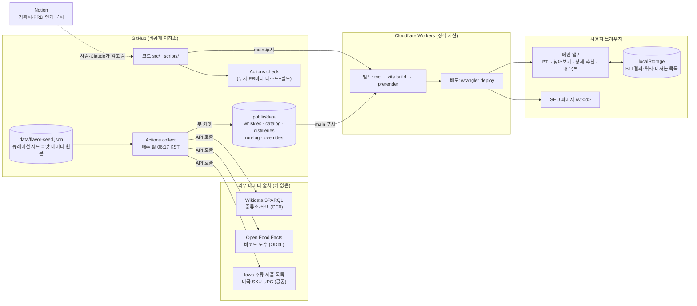
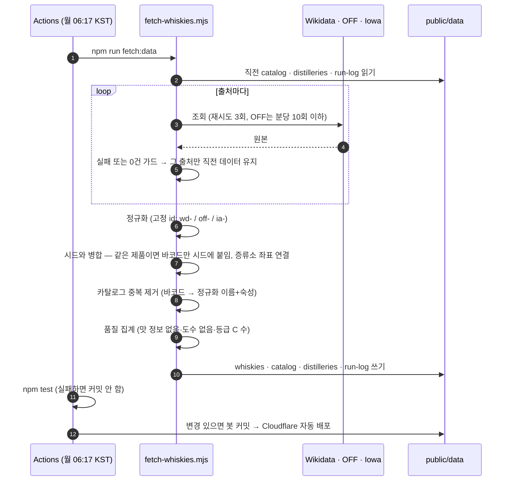
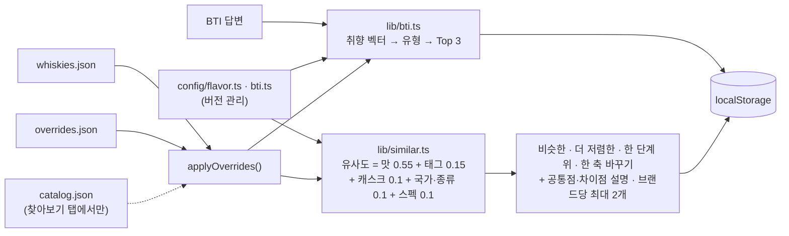

# 위스키 도감 시스템 구성도 (청약맵 기본 구성도 v1 적용)

> 이 문서는 **청약맵 기본 구성도 v1**(`taezzixo/dash_housing` 의 `docs/ARCHITECTURE.md`)을 위스키 도감에 맞게 옮긴 것입니다.
> 기본 구성도의 원칙(서버 없음 · 예약 수집 · JSON 커밋 · 자동 배포 · 계산은 브라우저)은 그대로이고, 달라진 점은 §0에 모았습니다.
>
> - 작성 기준일: 2026-11-13 · 버전: v0.1
> - 그림은 Mermaid입니다. GitHub에서 열면 그림으로 보입니다.

---

## 0. 기본 구성도 대비 달라진 점 (2026-11-13 확인 완료)

| # | 항목 | 청약맵 | 위스키 도감 |
|---|---|---|---|
| 1 | 저장소 | `dash_housing` 공개 | `taezzixo/whisky` **비공개** (Actions 무료 시간 안에서 충분) |
| 2 | 수집 주기 | 매일 06:17 KST | **매주 월요일 06:17 KST** — 제품 DB는 천천히 바뀜 |
| 3 | 출처 | 공공데이터포털 API (키 필요) | Wikidata · Open Food Facts · Iowa 주류 제품 목록 — **키 없음, Secrets 불필요** |
| 4 | 핵심 데이터 원본 | 수집 결과 | **큐레이션 시드**(`data/flavor-seed.json`)가 원본, 수집은 바코드·좌표·카탈로그 보강 |
| 5 | 핵심 항목 | `Notice` | `Whisky` — 고정 id · 출처 · 위치(증류소 좌표) · 원문 링크(refs) · 품질(등급 A/B/C) 유지, "날짜 묶음" 대신 "맛 벡터 10축" |
| 6 | 메인 화면 | 카카오 지도 | 위스키BTI + 비슷한 위스키 추천 (차트는 SVG 직접 구현, 지도 SDK 없음) |
| 7 | 브라우저 계산 | 자격 판정·가점 | BTI 취향 벡터·유형, 유사도·추천 모드 |
| 8 | 기준값 버전 관리 | `criteria.ts` | `config/flavor.ts`(가중치 `SIMILARITY_VERSIONS`), `config/bti.ts`(`BTI_VERSION`) |
| 9 | 사용자 입력 | 소득·자산 → localStorage | BTI 답·위시·마셔본 목록 → localStorage + JSON 내보내기 |
| 10 | 계정 | Supabase (선택) | **없음** — 커뮤니티(피드·제보)는 Phase 3에서 Supabase 검토 |
| 11 | 데이터 크기 대응 | 단일 파일 | `whiskies.json`(도감, 첫 화면) + `catalog.json`(검색 탭에서만 늦게 불러옴) 분리 |
| 12 | SEO 페이지 | `/n/<id>` | `/w/<id>` (맛 정보 있는 도감만) |
| 13 | 관리자 페이지 | `/admin.html` | v0.1 없음 — `run-log.json`과 `overrides.json`으로 운영, v0.2에서 추가 |

---

## 1. 전체 구성도



## 2. 주간 수집 파이프라인



## 3. 브라우저 안에서 일어나는 일



## 4. 데이터 모델

`src/types.ts` 참고. 요점:

| 필드 | 설명 |
|---|---|
| `id` | 고정. `seed-` `wd-` `off-` `ia-` `manual-` |
| `source`, `refs` | 출처와 원문 링크 |
| `flavor` | 10축 0~5. 없으면 추천 대상에서 빠지고 "맛 정보 준비 중" |
| `grade` | A 공식·검수 / B 커뮤니티 검증 / C 추정 |
| `price` | 참고 가격(만원, 700ml). 판매 정보 아님 |
| `lat`, `lng` | 증류소 좌표 (Wikidata) |
| `barcode` | EAN/UPC (OFF·Iowa에서 보강) |

## 5. 저장소 구조

```
whisky/
├─ CLAUDE.md · README.md · wrangler.jsonc
├─ .github/workflows/deploy.yml   # check(푸시·PR) + collect(주 1회 + 수동)
├─ data/flavor-seed.json          # 큐레이션 시드 (맛 데이터 원본)
├─ public/_headers · public/data/ # whiskies · catalog · distilleries · run-log · overrides
├─ scripts/
│  ├─ fetch-whiskies.mjs · make-sample.mjs · prerender.mjs
│  ├─ sources/                    # http(재시도) · wikidata · openfoodfacts · iowa
│  ├─ lib/normalize.mjs (+ test)  # 순수 함수 정규화·병합
│  └─ fixtures/                   # 파서 테스트용 고정 응답
├─ src/
│  ├─ App.tsx · types.ts · styles.css
│  ├─ components/                 # Bti · WhiskyDetail · WhiskyCard · Charts · Bottle
│  ├─ lib/                        # similar · bti · overrides · store (+ *.test.ts)
│  └─ config/                     # flavor(축·가중치 버전) · bti(문항·유형)
└─ docs/                          # ARCHITECTURE · API_KEYS · HANDOFF · PRD · PLAN_ORIGINAL
```

## 6. 키 배치

v0.1은 비밀 키가 없습니다. `SITE_URL`만 Cloudflare 빌드 변수에 둡니다. LLM 보강을 켜면 `ANTHROPIC_API_KEY`를 GitHub Secrets에만 둡니다(브라우저로 가지 않음). 목록은 `docs/API_KEYS.md`.

## 7. 알려진 제약

- 이 클라우드 작업 세션의 네트워크 정책은 세 출처 호스트를 막고 있습니다. 파서는 고정 응답으로 테스트했고, **실제 수집은 GitHub Actions 첫 실행에서 확인**해야 합니다.
- Wikidata의 "위스키 증류소" 분류(Q10373548)와 Iowa 데이터셋 열 이름은 첫 실행 결과로 검증이 필요합니다. 실패해도 그 출처만 비고 사이트는 정상 동작합니다.
- 맛 벡터는 시드 84종만 있습니다. 카탈로그 항목은 검색만 되고 추천에는 쓰이지 않습니다.
